# ISJ107V Assignment 4: Functional Prototype and Presentation

## Declarations

#### Original work

I, Malibongwe Mthethwa (213355813), declare that this report and the prototype it describes are my own work, except where stated below. Data and standards from other sources are cited in the references.

#### Use of AI tools

I used an AI assistant for code, design and diagrams, integrations, tests and documentation, and I reviewed and can explain all of it.

## Question 1: Prototype Scope and Readiness

### 1.1 Project, problem, users, purpose and technology

#### Project title

HydroSentinel, an AI-assisted water service risk monitoring platform for South African Water Service Authorities (WSAs).

#### Problem addressed

The Department of Water and Sanitation (DWS) publishes audit results for each WSA as long annual PDF reports (Department of Water and Sanitation, no date). Residents have no simple way to report a leak or outage and follow what happens to the report. Oversight staff have no single view of which authorities are at risk and which corrective action plans (CAPs) are under way.

#### Intended users

Citizens report problems and track them with a reference code, with no account. Municipal and oversight admins sign in to triage reports, run risk scoring, draft and accept CAP items and review alerts. Regulators read the public dashboard.

#### Prototype purpose

To show one complete workflow from a citizen report to a resolved case, with the AI components doing real work inside it. The workflow runs on real data for 169 WSAs loaded from DWS reports and the National Treasury Municipal Money API (National Treasury, no date).

#### Selected emerging technology

Artificial intelligence and machine learning. An XGBoost classifier (Chen and Guestrin, 2016) predicts a low, medium or high risk level for each WSA. OpenAI GPT-4o (OpenAI, no date) writes the acknowledgement a citizen sees, drafts CAP items for admins, and answers data questions through a fixed set of six database tools.

<div style="break-before:page"></div>

### 1.2 Functional requirements and implementation status

| ID | Requirement | Status | Notes |
|---|---|---|---|
| FR-01 | Public dashboard with risk map, WSA details and an AI national digest | Implemented | Digest cached for 24 hours |
| FR-02 | Citizen submits a report with type, description, map pin and photos | Implemented | Validated; image files only are stored |
| FR-03 | Citizen tracks a report with a reference code | Implemented | Hides location and description |
| FR-04 | Admin sign-in with access control on all admin functions | Implemented | JWT plus rotating refresh tokens |
| FR-05 | Admin triages reports (open, in review, resolved) with a note | Implemented | Reviewer and times recorded |
| FR-06 | Automatic alerts for high risk, risk increase, volume spike, geographic cluster and overdue CAP | Implemented | Deduplicated |
| FR-07 | Admin updates CAP status and due date | Implemented | Every change audited |
| ETR-01 | XGBoost risk scoring with a rule-based fallback | Implemented | Scoring through the API or a script |
| ETR-02 | GPT-4o drafts CAP items that an admin accepts | Implemented | Accept applies status and due date |
| ETR-03 | Regulatory questions answered from the DWS PDFs | Implemented | TF-IDF retrieval, then GPT-4o |
| FR-08 | Risk scoring button on the admin page | Partially implemented | Backend and script exist; no button |
| FR-09 | Shared AI rate limit across several servers | Partially implemented | Limit of 20 per hour is held in one process |
| FR-10 | Scheduled automatic re-scoring | Deferred | Scoring is run manually |
| FR-11 | Email or SMS to citizens when a status changes | Deferred | Citizens check the tracking page |

*Table 1. Requirements and status.*

### 1.3 Setup and access

#### Repository

https://github.com/Malodeity/hydrosentinel (public).

#### Required software

Python 3.12, Node.js 20, PostgreSQL 15 or later, and a current Chrome, Edge or Firefox. Docker Compose can start everything instead. No special hardware is needed. A laptop with 8 GB of memory was enough.

#### Steps

```bash
git clone https://github.com/Malodeity/hydrosentinel.git
cd hydrosentinel
cp .env.example .env        # then edit .env (see below)
cd backend && python -m venv .venv && .venv/bin/pip install -r requirements.txt
.venv/bin/uvicorn main:app --port 8000    # creates tables and admin
# second terminal, from backend/: swap in the real dataset
psql "$DATABASE_URL" -c "TRUNCATE wsa CASCADE" -f data/sample/wsa_sample.sql
cd ../frontend && npm install && npm run dev
```

Set `DATABASE_URL`, `JWT_SECRET_KEY` and `OPENAI_API_KEY` in `.env`. On first start the backend creates the tables, seeds the admin user and inserts 144 placeholder WSA rows. The `psql` command swaps those for the real dataset in `backend/data/sample/wsa_sample.sql` (169 authorities from the DWS reports and the Municipal Money API). The source PDFs are not in the repository, so the ETL cannot be rerun from a fresh clone. Without Docker, `MODEL_PATH` can stay as it is in `.env.example`: if that path is missing, the backend falls back to the bundled `ai/model.pkl`.

#### Access and test data

The public pages need no sign-in. The admin page uses the seeded test account from `.env.example` (`admin@hydrosentinel.co.za`, password `admin123`). These are test values for a local database and must be changed for any real deployment. The `OPENAI_API_KEY` is supplied by each user in a local, ignored `.env` file. Without a key, only the AI functions return 503 and the rest of the system keeps working.

## Question 2: Working Prototype

### 2.1 End-to-end workflow

The demonstrated workflow follows one report from a citizen to resolution. A top navigation bar links the Dashboard, Report Issue and Admin pages, and opening the Admin page without signing in redirects to the Sign in page. The steps are listed here in the order a user sees them.

1. A citizen opens Report Issue, picks a province, a WSA and an issue type, describes the problem, places a pin and optionally adds photos. The Submit button stays disabled until a province, a WSA and a description of at least 10 characters are present.
2. The server validates the request. An invalid issue type returns 422 and an unknown WSA returns 404. A valid report is saved and the citizen sees a reference code with an AI-written acknowledgement (Figure 1).
3. The citizen can enter the code on the same page to check the case status.
4. An admin signs in, filters the reports to the province, opens the report, sets it to "in review" and adds a note. The server records who reviewed it and when (Figure 2).
5. The admin scores the WSA with the risk model and asks the AI to draft a CAP. The admin accepts a drafted item and the CAP status and due date change (Figure 3).
6. The admin sets the report to "resolved". The citizen's tracking page now shows the new status. Every admin step is written to the audit log.

<figure>
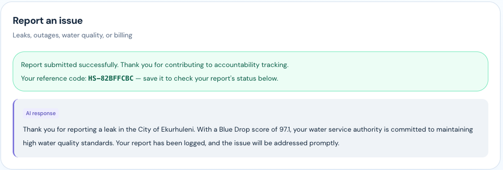
<figcaption>Figure 1. After a valid submission the citizen sees the reference code and the AI acknowledgement, which names the WSA and quotes its Blue Drop score.</figcaption>
</figure>


<figure>
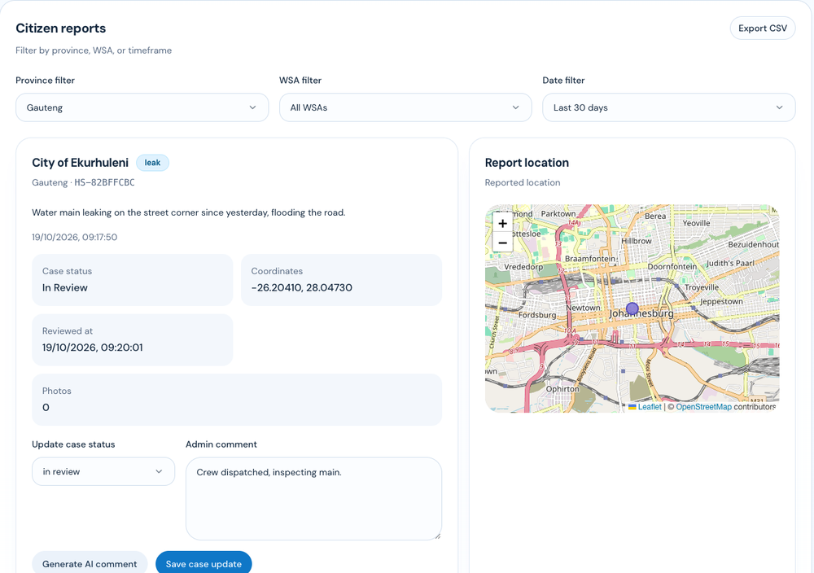
<figcaption>Figure 2. The admin page after the report moved to "in review". The Case status card shows the new status and the Reviewed at time. The note is saved with the status change.</figcaption>
</figure>


<figure>
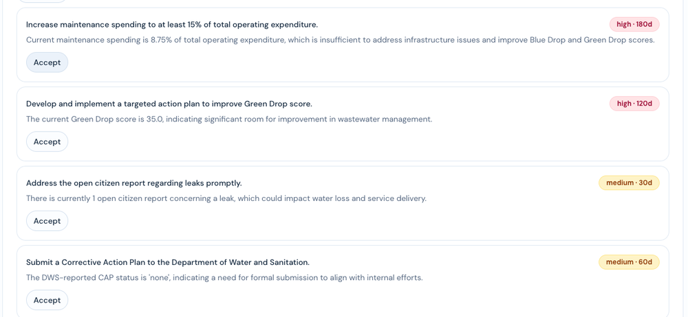
<figcaption>Figure 3. GPT-4o returns 3 to 5 CAP items, each with a priority, a due date in days and a justification that cites a number from the data. Nothing changes until the admin clicks Accept on an item.</figcaption>
</figure>


#### Error feedback

Server errors reach the user as plain messages. The sign-in page shows "Login failed. Check your email and password and try again.", the report form shows "We could not submit the report right now. Please try again.", and the AI drafting button shows "Could not generate a CAP draft for this WSA." when the call fails. The API returns 422 for invalid input, 404 for unknown records, 401 and 403 for missing or wrong credentials, 429 when the AI limit is reached, 503 when no OpenAI key is set and 502 when OpenAI fails.

### 2.2 Emerging-technology integration

Two AI components sit inside the workflow, and the system uses what each returns.

#### XGBoost risk classifier

The admin scoring request loads the WSA, builds six input features and asks the model for class probabilities. The result is used only if the model is loaded, the WSA has a Blue Drop score and the top class has at least 50% confidence. Otherwise a rule-based heuristic scores the WSA. The level and probability are stored in `RiskScoreHistory`, the WSA's risk level is updated, a high result raises an alert and an audit row is written. In the end-to-end test the model scored !Kai! Garib LM as medium with a probability of 0.83. The model was trained on 144 WSAs labelled by the DWS Blue Drop Risk Rating. On 29 held-out WSAs it reached 89.7% accuracy, and five-fold cross-validation gave 80.6% with a spread of 8.0 points. The heuristic reached 34.5% on the same held-out set, so the model matters.

#### GPT-4o

One helper makes every GPT-4o call, with a 30 second timeout and one retry. The citizen acknowledgement, the CAP draft, the digest and the data questions all go through it. For a CAP draft the server sends the WSA's indicators, its open reports and its latest score, and asks for 3 to 5 items as structured JSON. If the reply cannot be parsed into items, the server returns 502 and nothing is shown. The accepted item changes real data (CAP status and due date), which is how the AI output is "used by the system".

### 2.3 Data

PostgreSQL holds eight tables: WSAs, citizen reports, users, refresh tokens, risk score history, summaries, alerts and the audit log. The 169 WSA rows come from an ETL pipeline that reads five DWS PDF reports (Blue Drop, No Drop, the Blue Drop risk rating report, and the national and Gauteng Green Drop editions) and the Municipal Money API for maintenance spending. A matching key made from the province and a cleaned name joins differently spelled names, and a clean-up step merged the duplicates. Report photos are stored on disk and the database keeps only the path. The extracted WSA rows are committed as `backend/data/sample/wsa_sample.sql`, so the demonstration data can be restored on any machine. Reports, scores, alerts and audit rows created during the demonstration persist across restarts.

### 2.4 Security and reliability controls

| Control | How it is applied |
|---|---|
| Access control | Admin endpoints depend on `get_current_admin_user`. Requests with no token return 401, and non-admins return 403. |
| Sessions | Short-lived JWT plus a single-use refresh token. Only the SHA-256 hash of each refresh token is stored. Passwords are hashed with bcrypt. |
| Credentials | The OpenAI key, database URL and JWT secret live in `.env`, which is excluded from the repository. |
| Personal data | The public tracking endpoint returns only the case code, type, status, note and time. Location and description are not returned. |
| Upload safety | Only .jpg, .jpeg, .png, .webp and .gif files are stored. Other files are ignored. |
| AI cost and abuse | The CAP draft, data query and regulatory question endpoints allow 20 requests per admin per hour and then return 429. |
| Safe failure | A missing key, a timeout or an OpenAI error gives 503 or 502 for that feature only. The rest of the system keeps working. |
| Accountability | An append-only audit log records the user, action, old value, new value and address for every admin change. |

*Table 2. Security and reliability controls.*

#### Prototype evidence

| Requirement | Status | Prototype feature | Test case | Evidence |
|---|---|---|---|---|
| FR-02 | Implemented | Citizen report form | TC-01, TC-02, TC-03 | Figure 1, Table 4 |
| FR-03 | Implemented | Public tracking | TC-07 | Appendix A |
| FR-05 | Implemented | Admin triage | TC-04 | Figure 2 |
| ETR-01 | Implemented | XGBoost scoring | TC-05 | Table 4, Table 5 |
| ETR-02 | Implemented | GPT-4o CAP draft and Accept | TC-06 | Figure 3, Table 4 |
| FR-04, FR-07 | Implemented | Access control and audit | TC-08, TC-09 | Table 4, Appendix A |

*Table 3. Prototype evidence in the recommended format.*

## Question 3: UML Models

The five diagrams describe only the demonstrated workflow. They use UML 2.5.1 notation (Object Management Group, 2017) and were drawn in PlantUML (PlantUML, no date). The class names, fields and routes come from the code.

### 3.1 Use-case diagram

<figure>
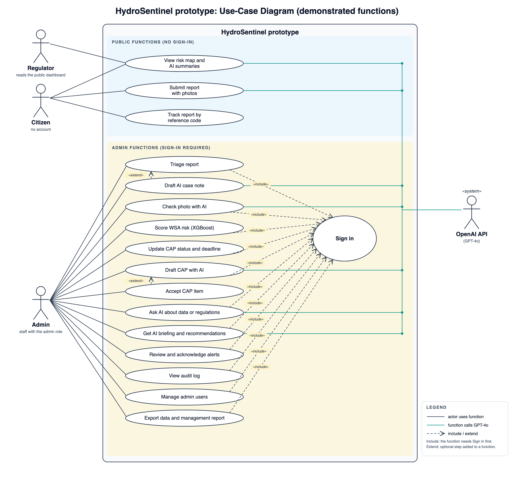
<figcaption>Figure 4. Four actors. Citizens submit and track reports and, with regulators, view the public risk map, all with no account. The admin signs in first, so each of the eleven admin functions that is not an optional step includes Sign in. Drafting an AI case note extends Triage report, and accepting a CAP item extends Drafting a CAP. OpenAI is an external actor for the seven functions that call GPT-4o: the map summaries, report submission, the case note, the photo check, the CAP draft, the data question and the briefing.</figcaption>
</figure>


### 3.2 Activity diagram

<figure>
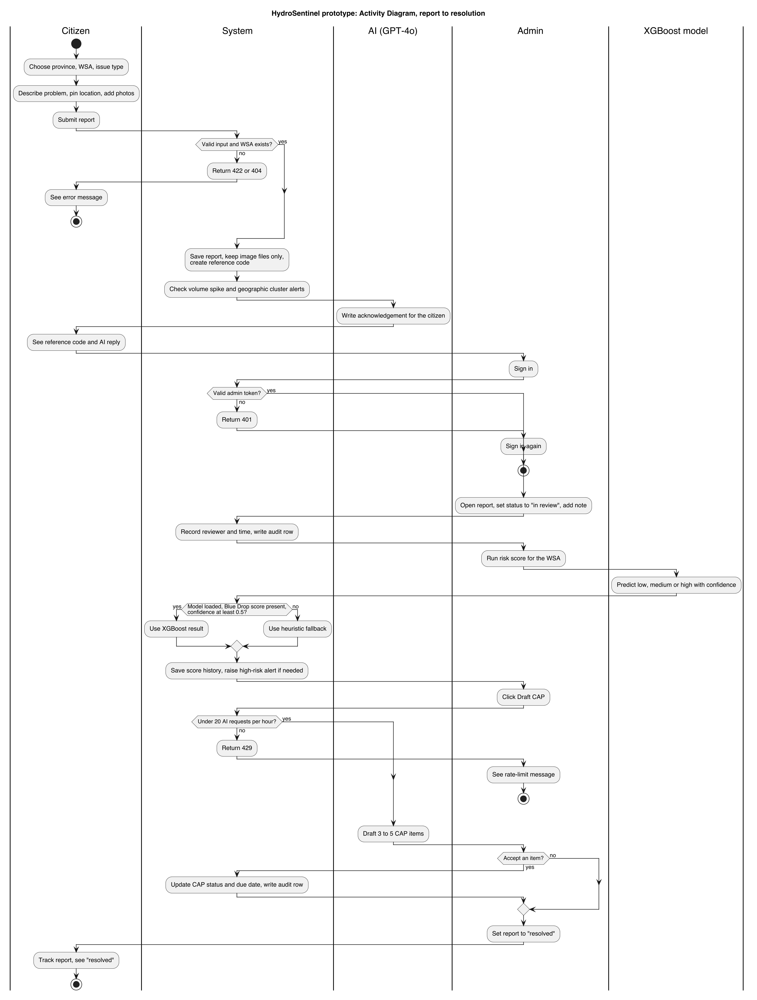
<figcaption>Figure 5. The diagram follows one report across five lanes. It has five decisions: input validity, admin token validity, model confidence (XGBoost or heuristic), the AI rate limit and whether the admin accepts a CAP item. The first, second and fourth end the flow early on failure. The AI step is the lane where GPT-4o drafts CAP items, and the model step is the lane where XGBoost predicts the level.</figcaption>
</figure>


### 3.3 Class diagram

<figure>
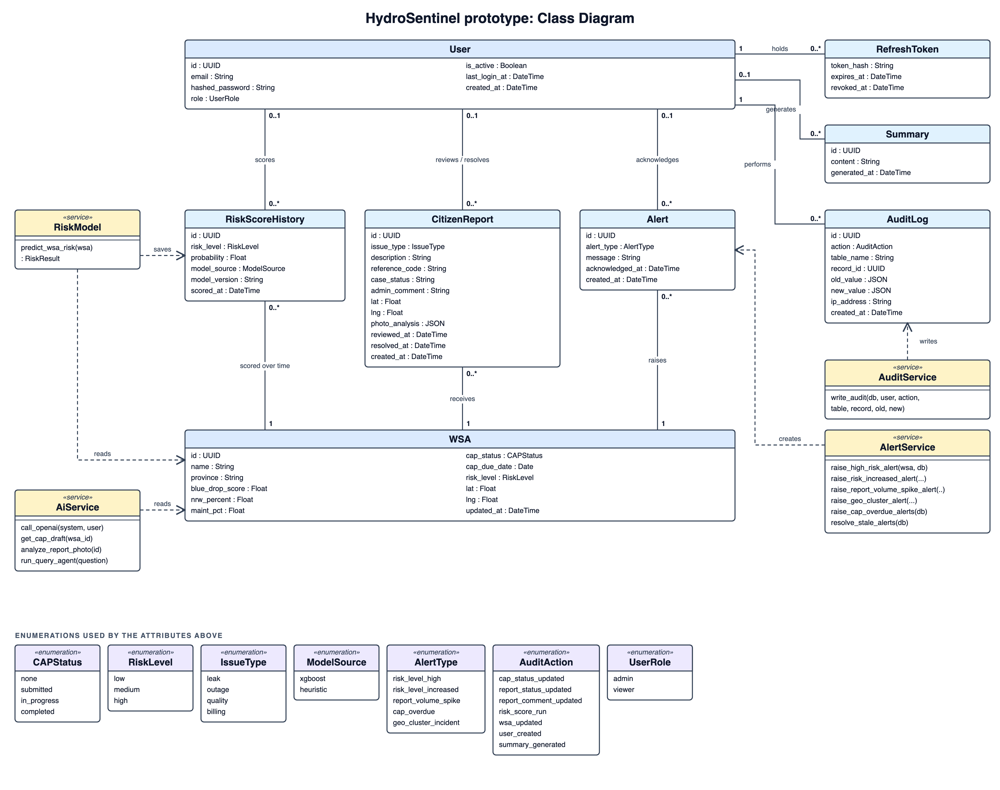
<figcaption>Figure 6. A WSA has many reports, score records and alerts. A User has many refresh tokens and audit rows, and a User may have generated summaries. A report, score, alert or summary has zero or one User attached (the admin who reviewed, scored, acknowledged or generated it). The four service classes show the operations the workflow calls: RiskModel saves scores and reads the WSA, AiService reads the WSA and its reports, AlertService creates alerts, and AuditService writes audit rows. The photo check result is stored as a JSON field on the report. The enumerations define the allowed values. Only the key attributes are drawn.</figcaption>
</figure>


### 3.4 Sequence diagram

<figure>
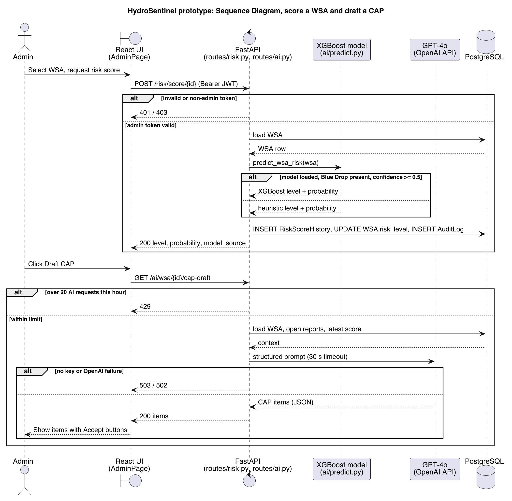
<figcaption>Figure 7. The admin interface calls FastAPI, which checks the token, reads the database, asks the XGBoost model or GPT-4o for a result and saves it. Each alternative frame shows a real failure path: a bad token, a model fallback, an exceeded limit and an OpenAI failure.</figcaption>
</figure>


### 3.5 Deployment diagram and design differences

<figure>
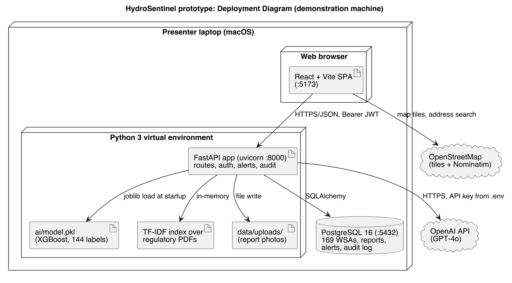
<figcaption>Figure 8. On the demonstration machine the browser runs the React app, a Python environment runs the API with the model and the retrieval index, and PostgreSQL runs on the same laptop. The API reaches OpenAI over the internet with a key from <code>.env</code>. The map tiles and address search come from OpenStreetMap.</figcaption>
</figure>


#### Differences between the design and the prototype

- The design called for the risk score to be refreshed whenever new data or reports arrive. The prototype scores on request, through the API or a script, and has no scoring button.
- The design assumed one shared rate limiter. The prototype keeps the counter in the memory of one process, so a restart clears it.
- The design assumed Docker Compose. For the demonstration the services run directly on the laptop, which changes only the host names and ports.

## Question 4: Testing, Measures and Limitations

### 4.1 Test cases

`backend/scripts/e2e_workflow.py` runs the cases below against the live backend and database. It passed 17 of 17 checks on a blank database set up with the steps in section 1.3, including a live GPT-4o call. The table shows the representative cases. The 184 automated backend tests and the 13 frontend tests also pass, and the frontend builds without type errors.

| ID | Area | Test | Expected result | Actual result | Status |
|---|---|---|---|---|---|
| TC-01 | Main workflow | Submit a leak report with one PNG and one text file | 201, one photo stored, reference code returned | 201, one photo stored | Pass |
| TC-02 | Invalid input | Submit with an issue type that does not exist | 422 | 422 | Pass |
| TC-03 | Data | Submit for a WSA id that does not exist | 404 | 404 | Pass |
| TC-04 | Main workflow | Admin sets the report to "in review" with a note | 200, reviewer recorded | 200, reviewer recorded | Pass |
| TC-05 | AI model | Score WSAs until one is scored by the model | 200, model source is xgboost | 200, xgboost, medium, 0.83 | Pass |
| TC-06 | AI model | Request a CAP draft from GPT-4o | 200, 1 to 6 items | 200, 5 items | Pass |
| TC-07 | Data | Track the report by reference code, then after resolving | Status open, then resolved; no location returned | As expected | Pass |
| TC-08 | Security | Read the admin report list with no token | 401 | 401 | Pass |
| TC-09 | Security | Sign in with a wrong password, then a wrong status value | 401, then 422 | 401, 422 | Pass |

*Table 4. Test cases and results, from `docs/a4/evidence/e2e_output.txt`.*

### 4.2 Quantitative measures

| Measure | Result | Source |
|---|---|---|
| Response time, list of 169 WSAs | Median 5 ms, 95th percentile 6 ms (30 requests) | `measurements.txt` |
| Response time, risk scoring | Median 5 ms (10 requests) | `measurements.txt` |
| Response time, admin report list | Median 3 ms (30 requests) | `measurements.txt` |
| GPT-4o CAP draft | 2.5 to 3.3 s over three WSAs, and 5.8 s in the final end-to-end run | A3 measurements, `e2e_output.txt` |
| Risk model accuracy | 89.7% held out (29 WSAs), 80.6% by five-fold cross-validation | A3 evaluation output |
| Heuristic accuracy, same held-out set | 34.5% | A3 evaluation output |
| Workflow completion | 17 of 17 end-to-end checks | `e2e_output.txt` |
| Automated tests | 184 backend and 13 frontend tests pass | pytest, Vitest |

*Table 5. Measures, taken on one laptop with the server and client on the same machine.*

The latency figures show a local system and not a deployed one. The model accuracy rests on 29 held-out WSAs, so one WSA moves it by about 3.4 points. That is why the cross-validation figure is reported next to it.

### 4.3 Limitations and corrective actions

#### Limitation 1: the risk model fails silently when it cannot load

During preparation, `.env` held a Docker-only model path. Run outside Docker, the model never loaded and every WSA was scored by the heuristic, which is far less accurate (34.5% against 89.7%). Nothing in the interface showed it. The prototype now falls back to the bundled model file and logs a warning, and a test covers it. For the final system, the admin page should show which source scored each WSA and the health check should fail when the model is missing.

#### Limitation 2: the rate limiter and the scoring are not production-ready

The 20-per-hour limit lives in the memory of one process, so a restart clears it and several servers would each allow 20. Scoring also runs only on request. For the final system the counter should move to a shared store such as Redis, and a scheduled job should re-score the WSAs after each data load.

Two smaller risks remain. The model's medium class is the weakest (recall 0.71 on 7 examples), and training labels cover only 144 of 169 WSAs. GPT-4o text can be wrong, which is why a CAP draft needs an admin click before it changes data.

## References

- Chen, T. and Guestrin, C. (2016) XGBoost: A scalable tree boosting system. Proceedings of the 22nd ACM SIGKDD Conference, pp. 785-794.
- Department of Water and Sanitation (no date) Blue Drop, Green Drop, No Drop and Blue Drop Risk Rating reports. Republic of South Africa. Available at: https://www.dws.gov.za
- National Treasury (no date) Municipal Money API. Republic of South Africa. Available at: https://municipalmoney.gov.za
- Object Management Group (2017) Unified Modeling Language, version 2.5.1.
- OpenAI (no date) API reference for chat completions. Available at: https://platform.openai.com/docs
- PlantUML (no date) PlantUML. Available at: https://plantuml.com

## Appendix A: Additional evidence

<figure>
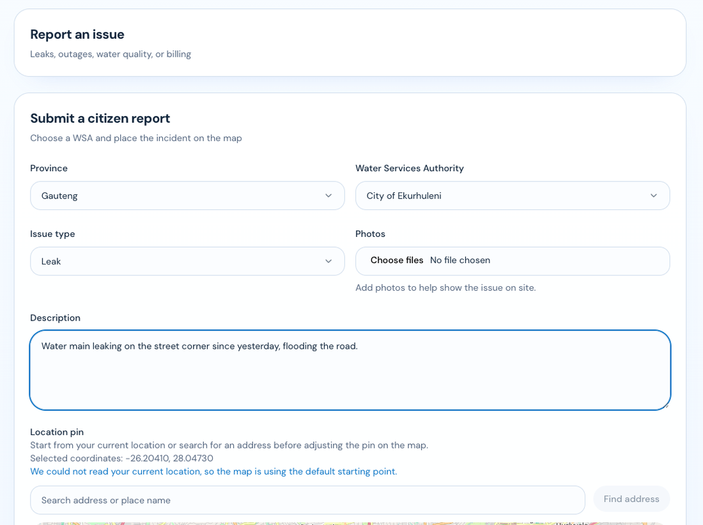
<figcaption>Figure A1. The form with a valid province, WSA, issue type and description before submission.</figcaption>
</figure>


<figure>
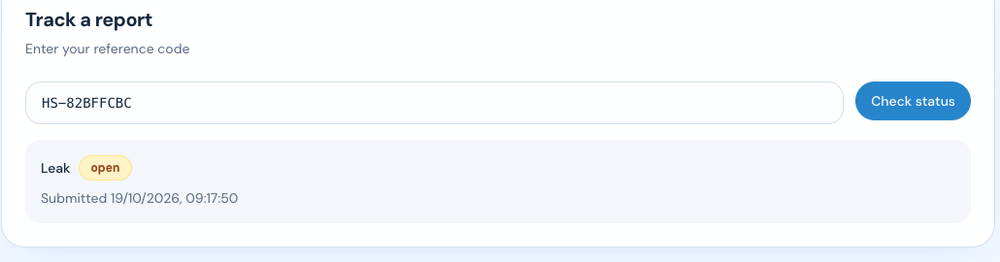
<figcaption>Figure A2. Entering the reference code shows the type, the status and the submission time, and nothing else.</figcaption>
</figure>


<figure>
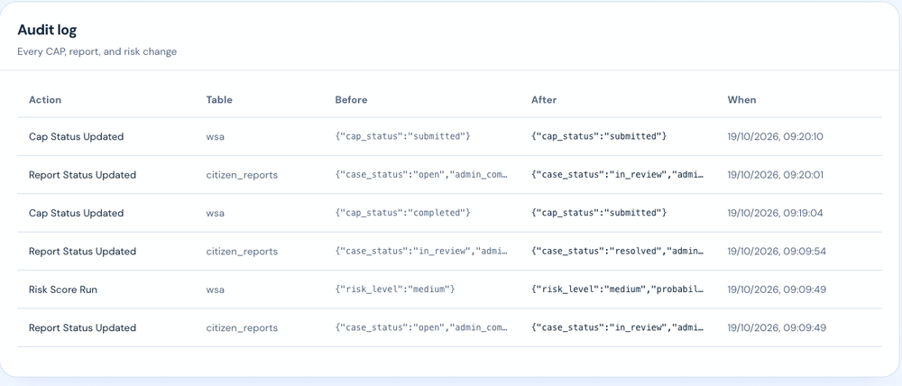
<figcaption>Figure A3. The audit log shows the status changes and the CAP change, each with the before and after values.</figcaption>
</figure>


#### End-to-end output

```text
PASS  WSAs are seeded  169 rows
PASS  TC-01 submit report with photo  201 17 ms
PASS  non-image upload is ignored  1 stored
PASS  TC-02 invalid issue_type rejected  422
PASS  TC-03 unknown WSA rejected  404
PASS  public tracking by reference code  
PASS  tracking hides location and description  
PASS  admin list needs a token  
PASS  wrong password rejected  401
PASS  admin login  
PASS  TC-04 admin triage  200
PASS  invalid case status rejected  422
PASS  TC-05 XGBoost risk score  !Kai! Garib LM medium p=0.8263 14 ms
PASS  TC-06 GPT-4o CAP draft  200 5 items 5787 ms
PASS  resolve report  
PASS  tracking shows resolved  
PASS  audit log records the actions  3 rows
17/17 passed
```
