# ISJ107V Assignment 5: Final System Presentation and Demonstration

## Declarations

#### Original work

I, Malibongwe Mthethwa (213355813), declare that this report and the system it describes are my own work, except where stated below. Data and standards from other sources are cited in the references.

#### Use of AI tools

I used an AI assistant for code, design and diagrams, integrations, tests and documentation, and I reviewed and can explain all of it.

## Question 1: Project Introduction and Roadmap

### 1.1 Project, problem, users, aim and value

#### Project title

HydroSentinel, an AI-assisted water service risk monitoring and repair platform for South African Water Service Authorities (WSAs).

#### Problem statement

The Department of Water and Sanitation (DWS) publishes audit results for each WSA as long annual PDF reports (Department of Water and Sanitation, no date). Citizens have no simple way to report a leak or outage and follow what happens to it. Oversight staff have no single view of which authorities are at risk. Authorities that hire contractors have no one place that shows who is fixing what and whether it was really fixed.

#### Intended users

- **Citizens** report a problem and track it with a reference code. They need no account.
- **Admins** sign in to triage reports, score risk, manage corrective action plans (CAPs) and assign repairs. A national admin sees every authority. An authority admin sees only one.
- **Contractors** sign in to see only their own repair tickets: accept or reject, start, and mark fixed.
- **Regulators** read the public dashboard.

#### Aim and value

The aim is one system from a citizen's report to a verified repair, with AI that rates risk and drafts work, and a person who always decides. A report no longer vanishes. It becomes a ticket with an owner, a due time and a check by the authority before it counts as resolved.

### 1.2 Final scope, requirements and changes

Requirement status was re-checked against the code on 16 November 2026. FR-01 to FR-07 and ETR-01 to ETR-03 are the Assignment 4 requirements. FR-08 was partial in Assignment 4 and is now complete. FR-12 to FR-18 are the approved change after Assignment 4.

| ID | Requirement | Status | Notes |
|---|---|---|---|
| FR-01 | Public dashboard with risk map, authority details and AI national digest | Completed | Digest cached for 24 hours |
| FR-02 | Citizen submits a report with type, description, map pin and photos | Completed | Image files only are stored |
| FR-03 | Citizen tracks a report with a reference code | Completed | Hides location and description |
| FR-04 | Admin sign-in with access control on every admin function | Completed | JWT plus rotating refresh tokens |
| FR-05 | Admin triages reports (open, in review, resolved) with a note | Completed | Reviewer and time recorded |
| FR-06 | Automatic alerts: high risk, increase, volume spike, cluster, overdue CAP, overdue ticket | Completed | Deduplicated |
| FR-07 | Admin updates CAP status and due date | Completed | Every change audited |
| FR-08 | Risk scoring from the admin page | Completed | "Score risk now" button; partial in Assignment 4 |
| FR-12 | Admin assigns a report to a contractor as a ticket; contractor accepts, works, marks fixed; admin verifies, which resolves the report | Completed | Approved change |
| FR-13 | A contractor sees only its own tickets and can never resolve a report | Completed | Another contractor's ticket returns 404 |
| FR-14 | Admin accounts can be limited to one authority | Completed | `users.wsa_id` |
| FR-15 | In-app notifications, optional email | Completed | Email tested with a mock only |
| FR-16 | Overdue tickets raise an alert | Completed | |
| FR-17 | AI drafts ticket instructions and suggests a contractor; a person confirms | Completed | Template text if OpenAI is down |
| FR-18 | Users change their own password; a national admin can reset one | Completed | Audited |
| ETR-01 | XGBoost risk scoring with rule-based fallback | Completed | 89.7% held out |
| ETR-02 | GPT-4o drafts CAP items that an admin accepts | Completed | |
| ETR-03 | Regulatory questions answered from the DWS PDFs | Completed | TF-IDF retrieval, then GPT-4o |
| FR-09 | AI rate limit shared across servers | Partial | 20 per hour held in one process |
| FR-10 | Scheduled automatic re-scoring | Deferred | Scoring is run on request |
| FR-11 | Email or SMS to citizens when a status changes | Deferred | Citizens use the tracking page |

*Table 1. Requirements and final status.*

#### Non-functional requirements

| Quality | Target | Result |
|---|---|---|
| Performance | List of 169 authorities in under 1 second on one laptop | 7 ms median, 9 ms 95th percentile |
| Security | Every admin and contractor function behind a token and a role | Tested (TC-08, TC-09, TC-12, TC-13) |
| Privacy | Public pages never show location, description or company | Tested (TC-07) |
| Reliability | An AI or mail failure must not stop the rest of the system | Tested (TC-15, TC-17) |
| Integrity | One open ticket per report even when two admins assign at once | Enforced by the database (TC-20) |
| Accountability | Every admin change recorded with who, when, before and after | Append-only audit log |

*Table 2. Non-functional requirements.*

#### Approved changes, deviations and incomplete items

- **Approved change:** contractor tickets (FR-12 to FR-18), added after Assignment 4.
- **Not done:** FR-09 (limit held in one process), FR-10 (no scheduler), FR-11 (no citizen email), and a photo on "fixed". Email has never been sent through a real mail server. The non-revenue-water figure is a labelled province estimate for display only.
- **Justified deviations from the design** are listed in section 3.5.

### 1.3 Roadmap, technology stack and emerging technology

The presentation runs in this order: the design in UML (use case, class, sequence, component, deployment, then consistency with the code), the live demonstration (about six minutes), then the evidence (tests, measures, users, limits) and my contribution.

| Layer | Technology |
|---|---|
| Frontend | React 18, TypeScript, Vite, Tailwind, shadcn/ui, Leaflet, axios |
| Backend | FastAPI, SQLAlchemy, PostgreSQL, JWT, bcrypt |
| Emerging technology | XGBoost classifier (Chen and Guestrin, 2016) and OpenAI GPT-4o (OpenAI, no date) |
| Data | DWS audit PDFs and the National Treasury Municipal Money API (National Treasury, no date), 169 authorities |
| Tests | pytest, Vitest, an end-to-end script against the live system |

*Table 3. Technology stack.*

The emerging technology is artificial intelligence and machine learning. XGBoost predicts a low, medium or high risk level for each authority. GPT-4o writes the citizen acknowledgement, drafts CAP items and ticket instructions, and answers data questions through six fixed database tools. The AI only drafts. A person assigns, accepts and verifies.

<div style="break-before:page"></div>

## Question 2: Final System Demonstration

The live demonstration follows one report from a citizen to a verified repair. Setup and access are in the repository README: `git clone`, copy `.env.example` to `.env`, start the backend and the frontend, or run `docs/a4/start_demo.sh`. Demo data comes from `docs/a5/reset_demo.sh`, which backs up the database and loads 24 curated reports across about 14 authorities with tickets at different stages.

### 2.1 End-to-end workflow

1. A citizen opens Report Issue, picks a province, an authority and an issue type, describes the problem, places a pin and adds photos. Submit stays disabled until a province, an authority and a description of at least 10 characters are present. A text file uploaded as a photo is ignored.
2. The server validates the request. A bad issue type returns 422 and an unknown authority returns 404. A valid report is saved and the citizen sees a reference code and an AI acknowledgement.
3. The citizen enters the code to track the report. The page shows the type, status and time, and nothing else.
4. A wrong password on the sign-in page gives a plain error and nothing is revealed. After a correct sign-in the admin opens the report, assigns it to a contractor and uses "Draft with AI" to write the instructions. The admin edits the draft and assigns.
5. The contractor signs in and sees only its own tickets. It accepts, starts and marks the job fixed. A fix without a note is refused with 422. Fixing before accepting returns 409.
6. The admin verifies the repair. Only now does the report become resolved, and the tracker shows the new status.
7. The admin scores an authority with the "Score risk now" button, and every step above is in the audit log.

<figure>
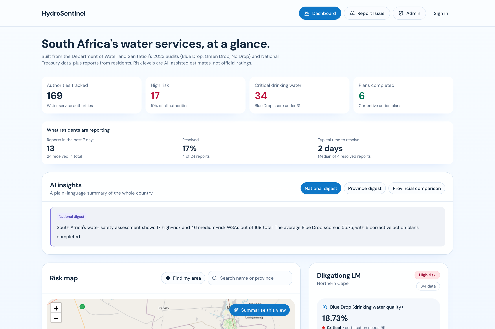
<figcaption>Figure 1. The public dashboard: risk map, authority list and AI national digest, built on data for 169 authorities.</figcaption>
</figure>

<figure>
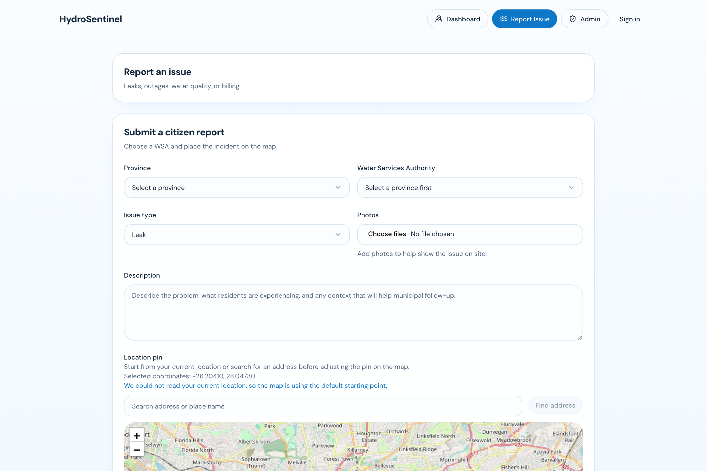
<figcaption>Figure 2. The citizen's report form. Submit stays disabled until the required fields are valid.</figcaption>
</figure>

<figure>
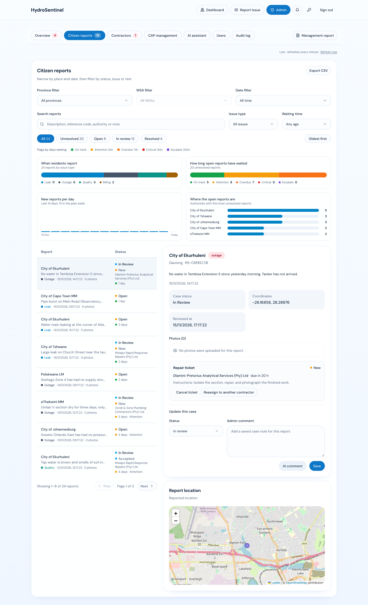
<figcaption>Figure 3. An admin opens a report, drafts ticket instructions with AI and assigns it. The ticket status appears on the report.</figcaption>
</figure>

<figure>
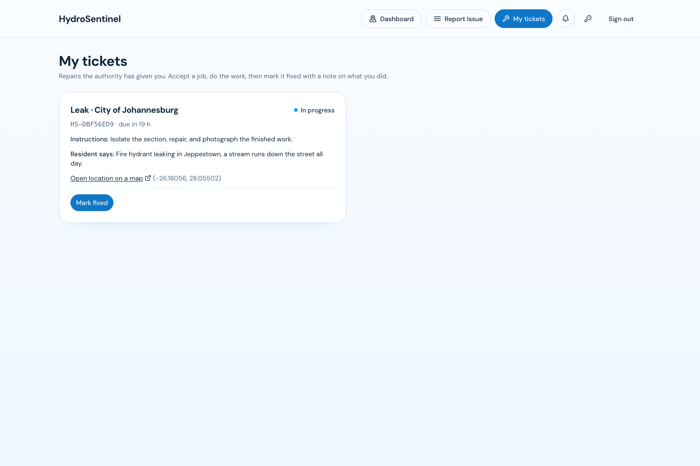
<figcaption>Figure 4. A contractor sees only its own tickets and moves them through accept, start and fixed.</figcaption>
</figure>

#### Error feedback and recovery

Errors reach the user as plain messages. The sign-in page says "Login failed. Check your email and password and try again." and the report form says "We could not submit the report right now. Please try again." The API returns 422 for invalid input, 404 for unknown records, 401 and 403 for missing or wrong credentials, 409 for a step taken out of order or a second open ticket, 429 when the AI limit is reached, 503 when no OpenAI key is set and 502 when OpenAI fails. Each failure affects only the feature involved.

### 2.2 Emerging-technology integration

#### XGBoost risk classifier

"Score risk now" loads the authority, builds six input features and asks the model for class probabilities. The result is used only if the model is loaded, the authority has a Blue Drop score and the top class has at least 50% confidence. Otherwise a rule-based heuristic scores it. The level and probability are saved in `RiskScoreHistory`, the authority's risk level is updated, a high result raises an alert and an audit row is written. In the end-to-end run, !Kai! Garib LM was scored medium with a probability of 0.83 by the model. The button shows the source ("Scored low (98.0%) by xgboost.") so a silent fallback is visible.

#### GPT-4o

One helper makes every GPT-4o call, with a 30 second timeout and one retry. For a ticket, the server sends the report, the authority's data and the contractors set up for that authority and issue type. GPT-4o returns draft instructions and suggests a contractor, and the admin edits and confirms. For a CAP draft, GPT-4o returns three to five items as structured JSON and nothing changes until the admin accepts one. If OpenAI is unavailable, the ticket draft falls back to template text and the rest of the page keeps working (TC-17).

### 2.3 Data persistence and integration

PostgreSQL holds the authorities, citizen reports, users, refresh tokens, risk score history, summaries, alerts, the audit log, contractors, contractor coverage, report assignments and notifications. The 169 authority rows come from an ETL pipeline that reads the DWS PDF reports and the Municipal Money API, and matches differently spelled names with a key made from the province and a cleaned name. The extracted rows are committed as `backend/data/sample/wsa_sample.sql`. Report photos are saved on disk and the database keeps the path. Reports, tickets, scores, alerts and audit rows persist across restarts. The external services are OpenAI (over the internet) and OpenStreetMap (map tiles and address search).

### 2.4 Security, privacy and reliability controls

| Control | How it is applied |
|---|---|
| Access control | Admin routes need an admin token (401 without, 403 for other roles). A contractor reaches only its own tickets. An authority admin is limited to one authority. Users, audit log and the AI question box are national-admin only. |
| Sessions and passwords | Short-lived JWT plus a single-use refresh token, stored only as a SHA-256 hash. Passwords are hashed with bcrypt. Users can change their password, which ends their other sessions. A national admin can reset one. |
| Credentials and errors | The OpenAI key, database URL and JWT secret live in `.env`, which is not in the repository. Demo logins are created only when `SEED_DEMO_DATA=true`. Errors show plain messages and never a stack trace or a key. |
| Privacy | The public tracker returns only the code, type, status, note and time. Location, description, photos and the contractor company are hidden. Photos go to OpenAI only when an admin presses "Analyse photo". |
| Business rules on the server | A contractor can never resolve a report; only the authority's verify does. Another contractor's ticket returns 404 so ids cannot be probed. |
| Data integrity | A partial unique index in PostgreSQL allows one open ticket per report. The second of two simultaneous assigns gets 409. |
| Upload safety | Only .jpg, .jpeg, .png, .webp and .gif files are stored. |
| AI cost and abuse | The AI endpoints allow 20 requests per user per hour, then return 429. |
| Accountability | An append-only audit log records the user, action, old value, new value and address. |

*Table 4. Security, privacy and reliability controls.*

#### Prototype evidence in the recommended format

| Requirement | Status | Feature | Test case | Evidence |
|---|---|---|---|---|
| FR-02 | Completed | Citizen report form | TC-01, TC-02, TC-03 | Figure 2, `e2e_output.txt` |
| FR-03 | Completed | Public tracking | TC-07 | `e2e_output.txt` |
| FR-05 | Completed | Admin triage | TC-04 | `e2e_output.txt` |
| FR-12 | Completed | Contractor tickets | TC-10, TC-14 | Figures 3 and 4, `e2e_output.txt` |
| FR-08, ETR-01 | Completed | "Score risk now", XGBoost | TC-05 | Figure 5, Table 8 |
| ETR-02 | Completed | GPT-4o CAP draft | TC-06 | `e2e_output.txt` |
| FR-04, FR-13 | Completed | Access control | TC-08, TC-09, TC-12 | `pytest_full.txt` |

*Table 5. Requirement to test to evidence.*

<figure>
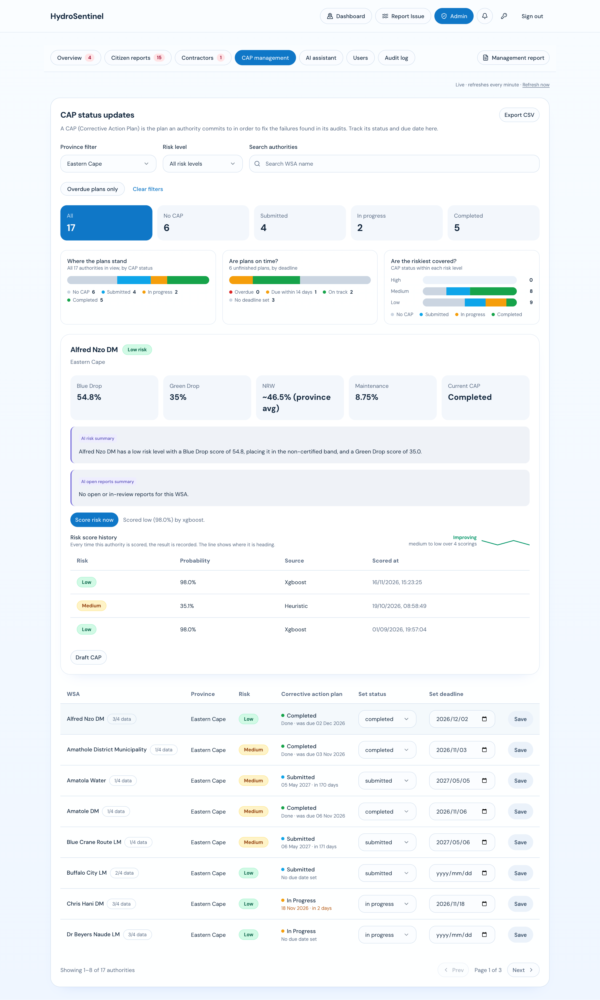
<figcaption>Figure 5. "Score risk now" on the CAP tab. The result shows the level, the probability and the source (xgboost).</figcaption>
</figure>

## Question 3: UML Models

The five diagrams describe the completed system. They use UML 2.5.1 notation (Object Management Group, 2017) and were drawn in PlantUML (PlantUML, no date). The editable `.puml` sources are submitted with the slides. The class diagram is generated from `backend/app/models.py`, and a script checks every route, file and class named on the diagrams against the running code (60 names, 0 mismatches).

### 3.1 Use-case diagram

<figure>
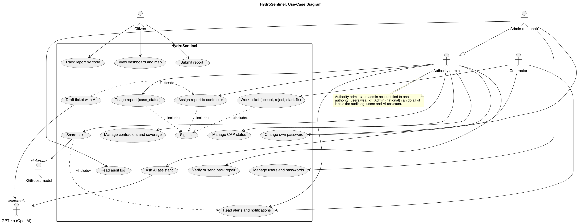
<figcaption>Figure 6. Actors: Citizen, Admin (national), Authority admin and Contractor, plus GPT-4o (external) and the XGBoost model (internal). Citizens use the public functions with no account. Admins triage, assign, verify, score risk and manage contractors and users. Contractors work only their own tickets. GPT-4o serves the functions that draft or explain text, and the XGBoost model serves risk scoring.</figcaption>
</figure>

### 3.2 Class diagram

<figure>
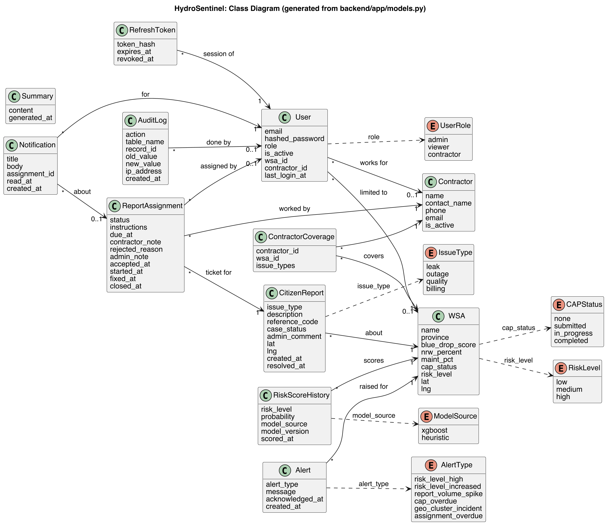
<figcaption>Figure 7. Generated from <code>models.py</code>. A WSA has many reports, score records and alerts. A report has at most one open <code>ReportAssignment</code> to a <code>Contractor</code>, and a contractor is linked to authorities and issue types through <code>ContractorCoverage</code>. A <code>User</code> has a role (<code>UserRole</code>) and an optional authority.</figcaption>
</figure>

Key design decisions:

- **Ticket in its own table.** `ReportAssignment` is separate from `case_status`, so the tracker, the CSV export and older reports keep working. A ticket has its own steps and history.
- **One open ticket per report** is enforced by a partial unique index, not only by code.
- **Coverage.** A contractor receives only reports for an authority and issue type it is set up for (`ContractorCoverage`).
- **Role and scope on the user.** `UserRole` and an optional authority limit what each login can reach.

### 3.3 Sequence diagram

<figure>
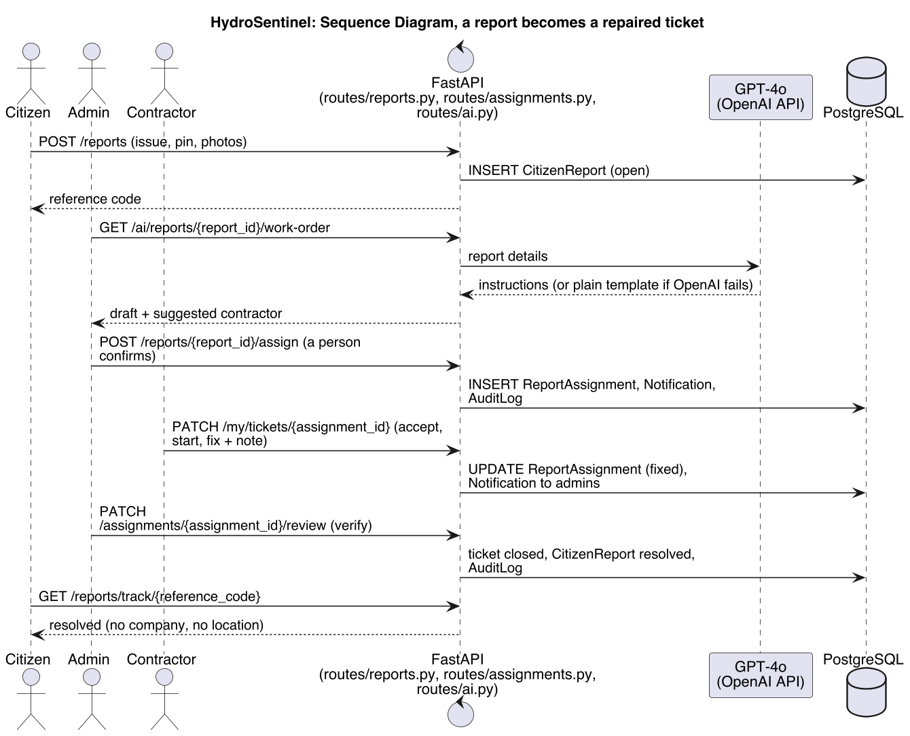
<figcaption>Figure 8. One report from citizen to verified repair: <code>POST /reports</code>, the AI ticket draft at <code>/ai/reports/{report_id}/work-order</code>, the contractor's <code>PATCH /my/tickets/{assignment_id}</code>, and the admin's <code>PATCH /assignments/{assignment_id}/review</code>. The AI call is a draft that a person confirms.</figcaption>
</figure>

### 3.4 Component and deployment views

<figure>
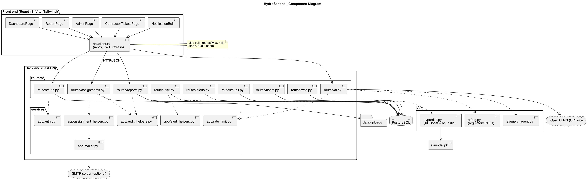
<figcaption>Figure 9. The React pages call the API through one client (axios, JWT, refresh). FastAPI routers use the services (auth, assignment rules, alerts, audit, mailer, rate limit) and the AI modules (XGBoost prediction with a heuristic fallback, regulatory retrieval, the query agent). Data persists in PostgreSQL, photos on disk and the model in <code>ai/model.pkl</code>. OpenAI and the optional SMTP server are external.</figcaption>
</figure>

<figure>
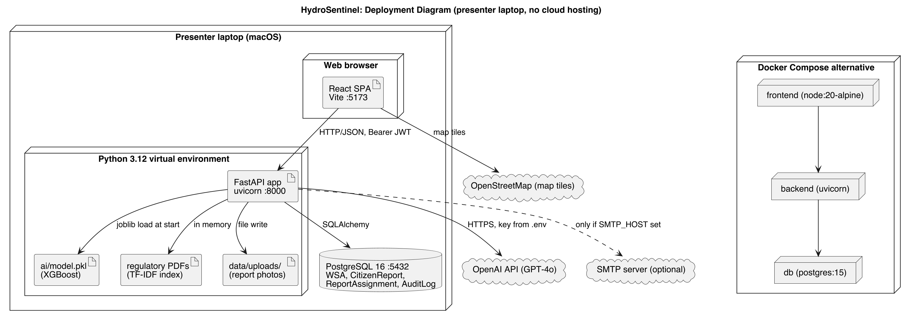
<figcaption>Figure 10. The system runs on one presenter laptop: the browser runs the React app, a Python environment runs the API with the model and the retrieval index, and PostgreSQL runs on the same machine. Docker Compose is the alternative. The API reaches OpenAI over the internet, and the map tiles come from OpenStreetMap. There is no cloud hosting.</figcaption>
</figure>

### 3.5 Consistency and justified deviations

| Check | Result |
|---|---|
| Names on the diagrams exist in the code (routes, files, classes) | 60 checked, 0 mismatches (`docs/a5/uml/NAME_AUDIT.md`) |
| Class diagram | Generated from `models.py`, so it cannot drift |
| Requirements to diagrams | FR-12 to FR-18 appear in the use-case, class and sequence diagrams |

*Table 6. Consistency checks.*

Justified deviations:

1. Contractor tickets are a separate table rather than a new case status, so the citizen tracker and old reports keep working.
2. Switching a contractor off stops new tickets only. It can still finish tickets it holds. The first version locked it out and stranded repairs, which I found in review.
3. One open ticket per report is enforced by a PostgreSQL index added after the design, because code alone could not stop two admins assigning at the same moment.
4. Risk scoring is on request, not scheduled (FR-10), which keeps the first release small.

## Question 4: Evidence, Responsible Use and Limits

### 4.1 Test results

| Level | What | Passed | Failed | Unresolved |
|---|---|---|---|---|
| Backend | pytest on the real database, with rollback | 279 | 0 | 0 |
| Frontend | Vitest | 109 | 0 | 0 |
| Static | TypeScript type check | 0 errors | | |
| Integration and system | `scripts/e2e_workflow.py` against the live backend, database and GPT-4o | 27 | 0 | 0 |
| User acceptance | 3 testers, 4 tasks each | __ of 12 | __ | __ |

*Table 7. Test summary, run on 16 November 2026. Sources are in `docs/a5/evidence/`.*

Not covered by automation: a real mail server (email was tested with a mock), and the browser screens, which are checked by hand and by the user sessions.

#### Representative test cases

| ID | Type | Case | Expected | Actual | Status |
|---|---|---|---|---|---|
| TC-01 | Main workflow | Submit a report with a PNG and a text file | 201, one photo kept | 201, one photo | Pass |
| TC-02 | Invalid input | Unknown issue type | 422 | 422 | Pass |
| TC-03 | Data | Unknown authority id | 404 | 404 | Pass |
| TC-04 | Main workflow | Admin sets "in review" with a note | 200, reviewer recorded | as expected | Pass |
| TC-05 | Emerging tech | Score an authority | 200, xgboost | xgboost, medium, 0.83 | Pass |
| TC-06 | Emerging tech | GPT-4o CAP draft | 200, 1 to 6 items | 5 items | Pass |
| TC-07 | Privacy | Track by code | status only | as expected | Pass |
| TC-08 | Security | Admin list with no token | 401 | 401 | Pass |
| TC-09 | Security | Wrong password | 401 | 401 | Pass |
| TC-10 | Main workflow | Assign, accept, start, fix, verify | report resolved | as expected | Pass |
| TC-11 | Security | Another contractor's ticket | 404 | 404 | Pass |
| TC-12 | Security | Contractor calls an admin route | 403 | 403 | Pass |
| TC-13 | Access | Authority admin reads another authority | 403 | 403 | Pass |
| TC-14 | Invalid input | Fix without a note | 422 | 422 | Pass |
| TC-15 | Reliability | Assign while the mail server fails | ticket still created | created | Pass |
| TC-16 | Business rule | Contractor not set up for that authority or issue | 422 | 422 | Pass |
| TC-17 | Integration | Work-order draft with OpenAI unavailable | template text | template | Pass |
| TC-18 | Security | Change password: wrong current, short new, success, old token dead | 400, 422, 204, 401 | as expected | Pass |
| TC-19 | Reliability | Switched-off contractor finishes a held ticket, gets no new one | 200, then 409 | as expected | Pass |
| TC-20 | Data integrity | Second open ticket on one report | refused by database | refused | Pass |

*Table 8. Test cases and results.*

#### User acceptance testing

Three people who had not seen the system each tried four tasks: report a leak with a photo and keep the code, check the report by its code, assign it as an admin, and accept and fix it as a contractor. The form is `docs/a5/uat_form.md`. The results are in Table 9.

| Tester | Task 1 | Task 2 | Task 3 | Task 4 | Average rating (1 to 5) | Main comment |
|---|---|---|---|---|---|---|
| A | __ | __ | __ | __ | __ | __ |
| B | __ | __ | __ | __ | __ | __ |
| C | __ | __ | __ | __ | __ | __ |

*Table 9. User acceptance results. Task success: __ of 12. Issues found: __. Fixed: __. Unresolved: __.*

### 4.2 Quantitative measures and emerging-technology metric

| Measure | Result | Source |
|---|---|---|
| Response time, list of 169 authorities | Median 7 ms, 95th percentile 9 ms (50 calls) | `measurements.txt` |
| Response time, report submission with one photo | Median 6 ms, 95th percentile 9 ms (50 calls) | `measurements.txt` |
| Response time, admin report list | Median 43 ms, 95th percentile 65 ms (50 calls) | `measurements.txt` |
| Response time, risk scoring | Median 7 ms, 95th percentile 9 ms (20 calls) | `measurements.txt` |
| Workflow completion | 27 of 27 end-to-end checks | `e2e_output.txt` |
| **XGBoost accuracy** (emerging-technology metric) | **89.7%** held out (26 of 29), 80.6% by five-fold cross-validation | Assignment 3 evaluation |
| Rule-based baseline, same held-out set | 34.5% | Assignment 3 evaluation |
| GPT-4o CAP draft time | 2.7 s and 4.1 s in the last two runs | `e2e_output.txt` |

*Table 10. Measures, taken on one laptop with server and client on the same machine.*

The timings describe a local system, not a deployed one. The accuracy rests on 29 held-out authorities, so one authority moves it by about 3.4 points, which is why the cross-validated figure is shown next to it.

### 4.3 Benefit and responsible use

#### Expected benefit

A citizen's report becomes a ticket with an owner, a due time and a check by the authority before it is called resolved. Oversight staff get one view of risk and one place that shows which repairs are late. The AI saves staff time by drafting text and a first risk rating.

#### Privacy and ethics consideration

Reports can contain a home address and photos of private property. The public tracker therefore returns only the code, type, status and time. A contractor sees location and photos only for the ticket assigned to it, and another contractor's ticket returns 404. Photos go to OpenAI only when an admin presses "Analyse photo". The AI never changes data by itself: a person assigns, accepts and verifies. GPT-4o text can be wrong, so every draft needs a click from an admin before it takes effect.

### 4.4 Principal limitation and future enhancement

**Limitation.** Risk scoring is manual and the model's accuracy rests on 29 held-out authorities. The AI limit lives in the memory of one process, so a restart clears it, and email has never been sent through a real mail server (FR-09, FR-10, FR-15).

**Future enhancement.** A scheduled job that re-scores the authorities after each data load, followed by a notice to the citizen when a ticket is verified (FR-11). Both build on the existing alert and notification tables.

## Question 5: Communication and Individual Mastery

### 5.1 Narrative, slides and delivery

The deck has 16 slides plus three backup slides: title, problem and users, scope and status, roadmap and stack, five UML slides, consistency, the live demonstration, test results, measures, benefit and privacy, limits, my contribution, and questions. Each slide carries one idea and the same names as the application, the diagrams and this report. The target is 14 minutes with a limit of 15, followed by about 5 minutes of questions.

| Time | Content |
|---|---|
| 0:00 to 1:45 | Problem, users, scope, roadmap, stack, emerging technology |
| 1:45 to 4:15 | UML: use case, class, sequence, component and deployment, consistency |
| 4:15 to 10:30 | Live demonstration (about six minutes) |
| 10:30 to 13:00 | Tests, measures, privacy, limits |
| 13:00 to 14:00 | Contribution, lesson and key decision |

*Table 11. Presentation timing.*

### 5.2 Moving between explanation and demonstration, and the fallback

I finish the design slides, say what the demonstration will show, and switch to the running system. The demonstration is scripted in `docs/a5/PRESENTATION_SCRIPT.md` with a timing for each step. Before presenting I run `docs/a5/reset_demo.sh` so the data looks the same each time.

| If this fails | I do this |
|---|---|
| OpenAI or Wi-Fi fails | Say so in one sentence. The template draft still appears, and the saved AI output is in `evidence/e2e_output.txt`. |
| The backend stops | Restart with `docs/a4/start_demo.sh` (about 10 seconds), or play the recorded video. |
| The data looks wrong | Run `docs/a5/reset_demo.sh`. |
| Projector or laptop trouble | Use the PDF slides and `docs/a5/screens/` on a second device. |

*Table 12. Fallback plan.*

The system runs entirely on the laptop. Only the AI functions need the internet. A recorded video of the full loop and a short clip of the AI step are the offline fallback.

### 5.3 Answering technical questions

I prepared answers that name the file or test that proves each point:

- **Why a separate ticket table?** The tracker, CSV and old reports depend on `case_status`. A ticket has its own steps. See `models.py`.
- **Why can a contractor not resolve a report?** Fixed is a claim and verifying is the authority's decision. See `test_contractor_cannot_skip_steps_or_resolve`.
- **Why 404 and not 403 for another contractor's ticket?** So ids cannot be probed. See `test_contractor_sees_only_own_tickets_and_cannot_touch_anothers`.
- **Two admins assign at once?** A partial unique index allows one open ticket per report and the loser gets 409. See `test_database_refuses_a_second_open_ticket_on_the_same_report`.
- **A contractor is switched off while holding tickets?** It keeps them and can finish, but gets no new ones. See `test_switched_off_contractor_can_still_finish_tickets_it_already_holds`.
- **What does the AI change without a person?** Nothing. It drafts, and a person assigns, accepts and verifies.
- **What leaves the system?** The report description, and a photo only when an admin asks for analysis. AI calls are limited to 20 per hour per user.

### 5.4 Personal contribution, lessons and key decision

**Contribution.** I defined the problem and the requirements, chose the architecture, designed the ticket rules, directed and reviewed the AI-assisted code, ran the tests and the user sessions, and prepared the diagrams and this report.

**Lessons learned.** I should check the real data first: the non-revenue-water figure was empty for all 169 authorities, so I labelled it as a province estimate. I should also enforce important rules on the server and not only in the screen. Reviewing my own first version found that a switched-off contractor was locked out of repairs it already held, and that two admins could assign the same report at once.

**Most important decision.** A person always decides. A contractor can mark a job fixed, but only the authority can verify it and resolve the report. The AI drafts and a person confirms. This keeps responsibility with the authority and limits the harm a wrong AI draft can do.

## References

- Chen, T. and Guestrin, C. (2016) XGBoost: A scalable tree boosting system. Proceedings of the 22nd ACM SIGKDD Conference, pp. 785-794.
- Department of Water and Sanitation (no date) Blue Drop, Green Drop, No Drop and Blue Drop Risk Rating reports. Republic of South Africa. Available at: https://www.dws.gov.za
- National Treasury (no date) Municipal Money API. Republic of South Africa. Available at: https://municipalmoney.gov.za
- Object Management Group (2017) Unified Modeling Language, version 2.5.1.
- OpenAI (no date) API reference for chat completions. Available at: https://platform.openai.com/docs
- PlantUML (no date) PlantUML. Available at: https://plantuml.com

## Appendix A: Additional evidence

<figure>
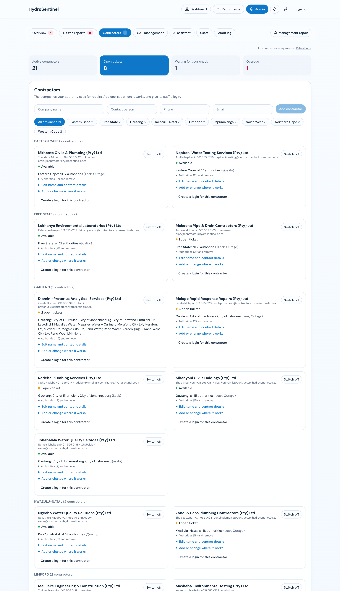
<figcaption>Figure A1. The Contractors tab: coverage by province, add all and remove all, and edit details.</figcaption>
</figure>

<figure>
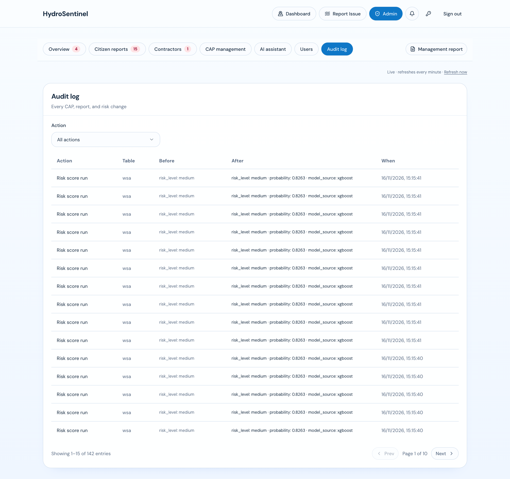
<figcaption>Figure A2. The audit log shows each admin and contractor action with who, when, and the before and after values.</figcaption>
</figure>

#### End-to-end output

```text
PASS  WSAs are seeded  169 rows
PASS  TC-01 submit report with photo  201
PASS  non-image upload is ignored  1 stored
PASS  TC-02 invalid issue_type rejected  422
PASS  TC-03 unknown WSA rejected  404
PASS  public tracking by reference code
PASS  tracking hides location and description
PASS  admin list needs a token
PASS  wrong password rejected  401
PASS  admin login
PASS  TC-04 admin triage  200
PASS  invalid case status rejected  422
PASS  TC-05 XGBoost risk score  !Kai! Garib LM medium p=0.8263
PASS  TC-06 GPT-4o CAP draft  200 5 items
PASS  resolve report
PASS  tracking shows resolved
PASS  audit log records the actions
PASS  TC-10 admin assigns report to contractor  201
PASS  tracker shows repair progress, not the company
PASS  contractor sees its ticket
PASS  TC-12 contractor cannot use admin routes
PASS  cannot fix before accepting  409
PASS  TC-14 fix without a note rejected  422
PASS  contractor marks fixed
PASS  fixed does not resolve the report
PASS  admin verifies, ticket closes
PASS  report is now resolved
27/27 passed
```
